# HurLink Communications: Plan Upgrade Portal

A Salesforce OmniStudio project for a fictional telecom provider, **HurLink Communications**. Customer service agents can upgrade a customer's home internet plan from the customer's record page, with live availability checks against an external network API, filtered plan options, an Apex-calculated promotion, and safe handling of every edge case.

Built with **OmniScripts, Integration Procedures, Data Mappers, FlexCards and Apex**, on a Financial Services Cloud org with OmniStudio (standard runtime).

---

## The business scenario

A customer calls HurLink asking for a faster internet plan. The agent needs to:

1. See who the customer is and what plan they currently have
2. Check which speeds the network can actually deliver at the customer's address (owned by a separate network system)
3. Offer only upgrades that make sense: faster than the current plan, and supported at that address
4. Apply any eligible promotion
5. Submit the change, so it is recorded and the customer's plan is updated

This project builds that end to end, starting from a single **Upgrade Plan** button on the customer's record.

---

## Demo

| Step | Screenshot |
|---|---|
| 1. The agent opens the customer's record. A FlexCard shows the current plan, with an **Upgrade Plan** button | 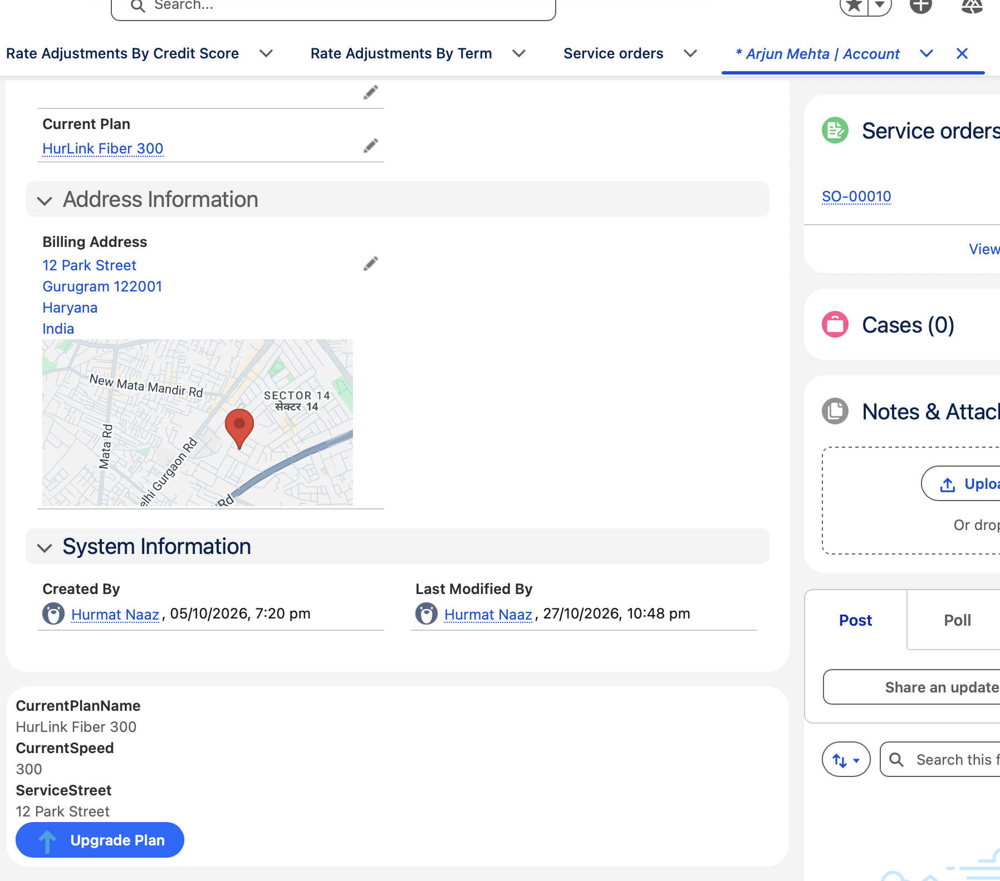 |
| 2. The OmniScript opens for that customer and shows the fastest speed available at their address, returned live by the network API | 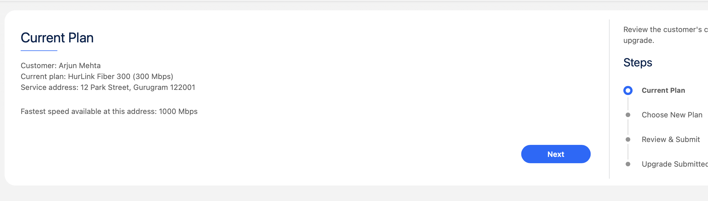 |
| 3. Only valid upgrades are offered: the current plan and plans the address cannot support are filtered out | 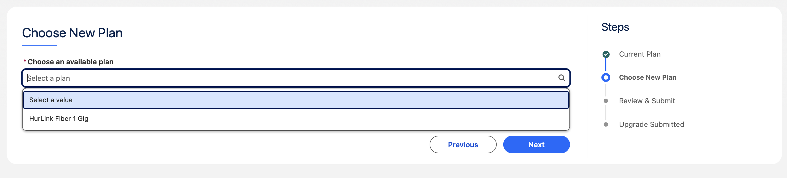 |
| 4. The review screen shows the final price, with the **UPGRADE20** promotion calculated in Apex | 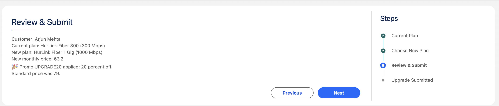 |
| 5. A clean confirmation, with no way to go back and resubmit, and a button back to the customer | 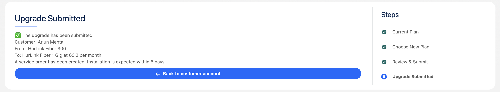 |
| 6. The change is saved as a Service Order, including the promo price and code | 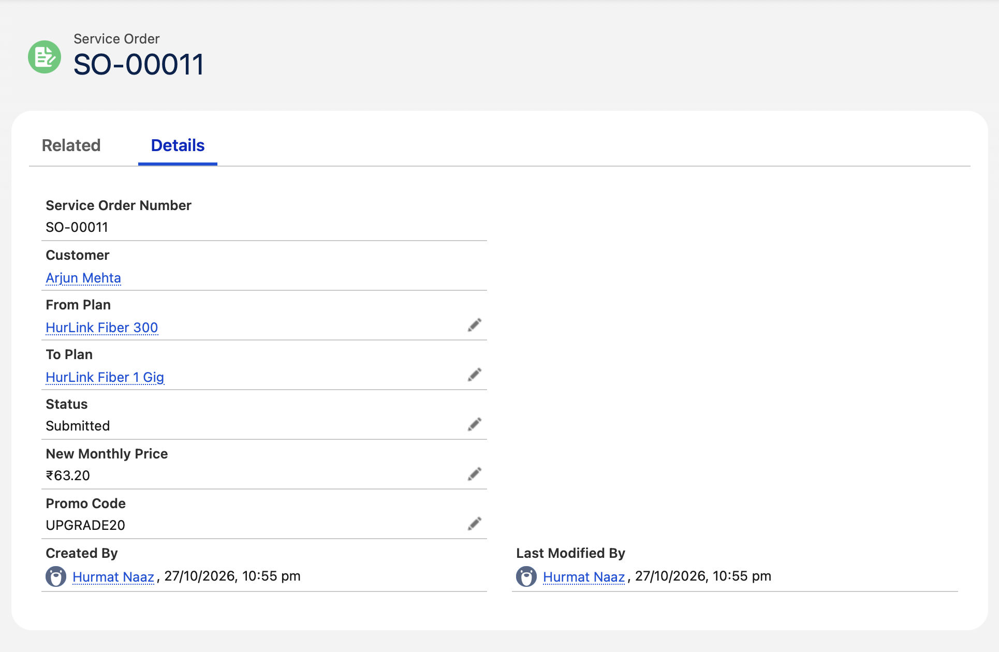 |

### Edge cases

| Scenario | Screenshots |
|---|---|
| **Customer is already on the fastest plan available at their address.** The agent sees a clear explanation, the upgrade screens are skipped, and nothing can be submitted | 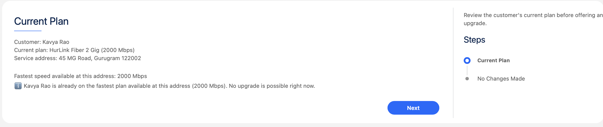 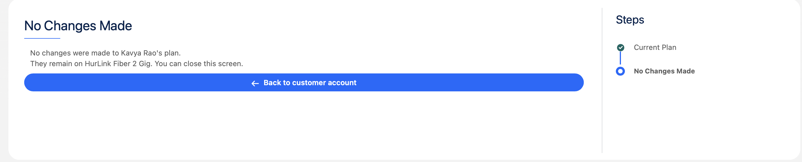 |
| **The external network API is down (HTTP 503).** The agent is told to try again later, instead of seeing empty or misleading information | 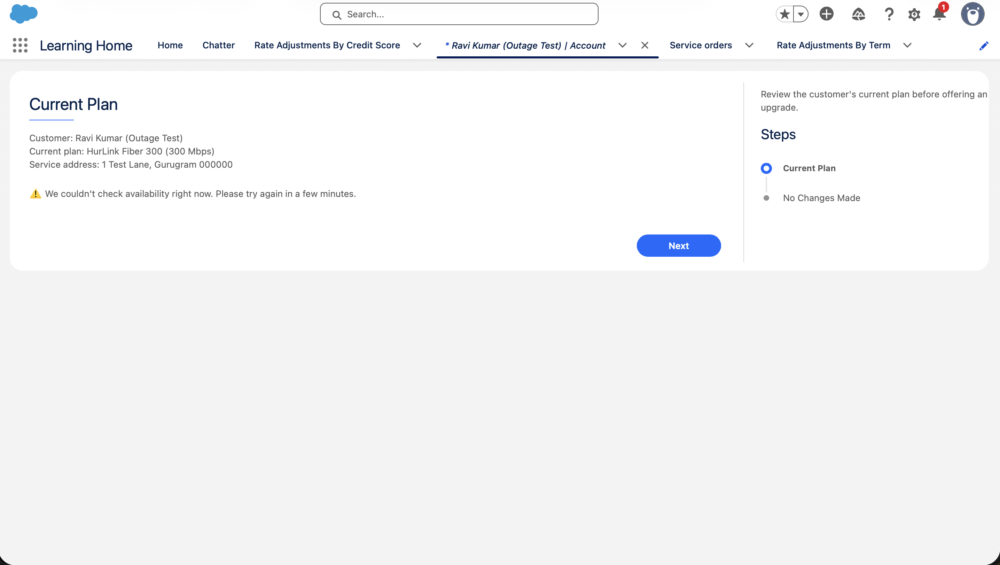 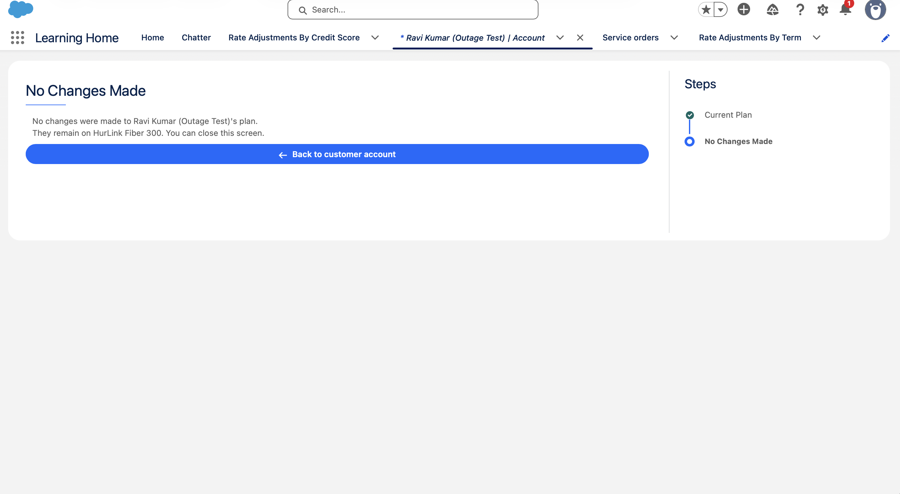 |

### Behind the scenes

| Component | Screenshot |
|---|---|
| Integration Procedure `HurLink_CheckAvailability` | 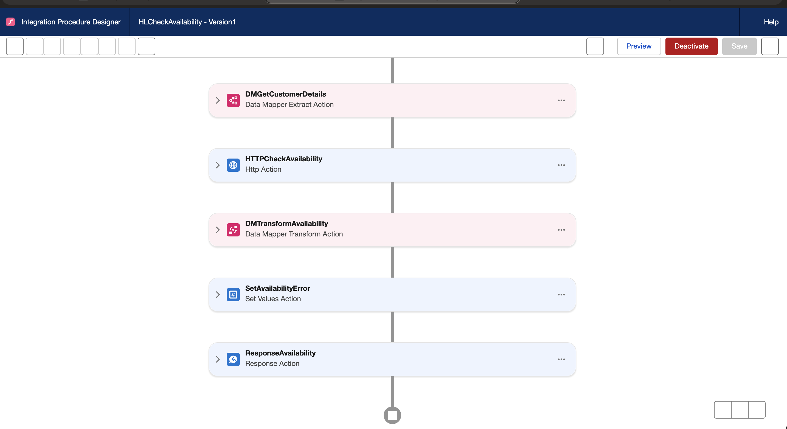 |
| HTTP Action calling the network API through a Named Credential | 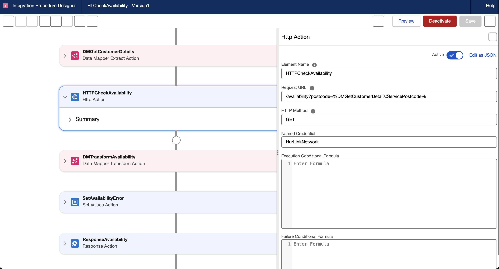 |
| OmniScript `HurLink / UpgradePlan` | 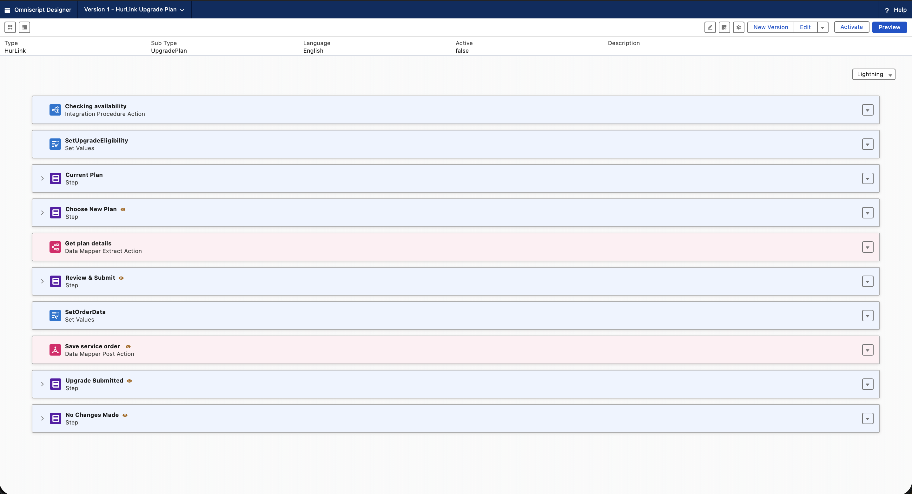 |
| Apex test results: 4 tests passing, 100% coverage | 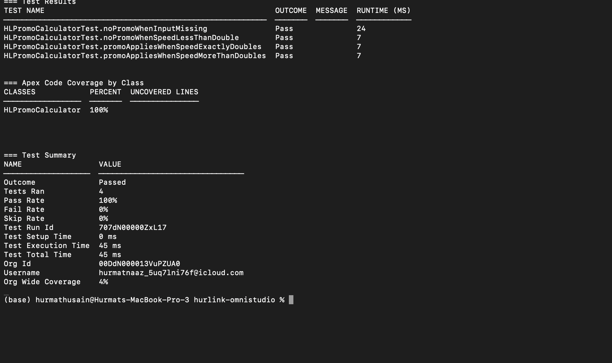 |

---

## Architecture

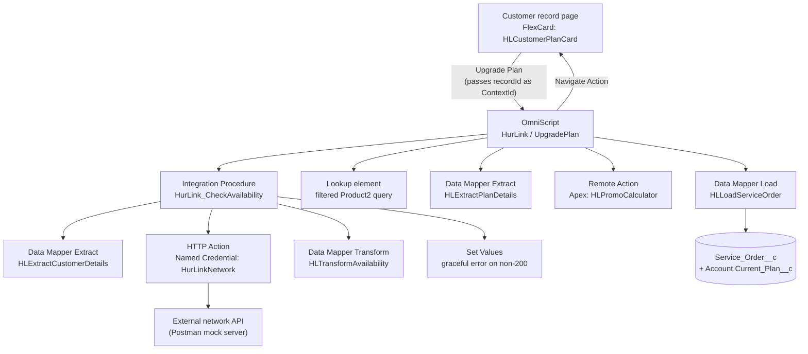

### How a single upgrade flows

1. **FlexCard** (`HLCustomerPlanCard`) on the HurLink Customer record page reads the current plan through `HLExtractCustomerDetails`, and its **Upgrade Plan** action opens the OmniScript, passing `{recordId}` as the ContextId.
2. **Integration Procedure** (`HurLink_CheckAvailability`) runs before the first screen:
   - extracts the customer and their current plan (a two-step Extract, chaining Account to Product2 through the `Current_Plan__c` lookup)
   - calls the external availability API with the customer's postcode, using a merge field in the request path
   - transforms the API's response (`max_speed_mbps`, `available_speeds`…) into internal naming (`MaxSpeed`, `AvailableSpeeds`…)
   - on any non-200 status, skips the transform and returns a user-friendly error message instead
   - returns one consistent response: `Customer`, `AvailabilityChecked`, `Availability`, `ErrorMessage`
3. **Eligibility flag**: a Set Values formula calculates `CanUpgrade` (availability check succeeded **and** current speed is below the address maximum). It drives conditional views on the remaining screens and actions.
4. **Plan selection**: a **Lookup** element queries Product2 for active internet plans that are faster than the current plan and no faster than the address maximum, using values from the OmniScript's data JSON as input parameters.
5. **Plan details**: `HLExtractPlanDetails` looks up the selected plan's name, speed and monthly price (Product2 + PricebookEntry).
6. **Promotion**: a **Remote Action** calls the Apex class `HLPromoCalculator`, which applies **UPGRADE20** (20 percent off) when the new speed is at least double the current speed.
7. **Save**: Set Values prepares the order data, and `HLLoadServiceOrder` inserts a `Service_Order__c` and updates the customer's `Current_Plan__c` in one Load.
8. **Finish**: the confirmation (or "No Changes Made") screen hides Previous, Next and Save for Later, and a Navigate Action returns the agent to the customer's record.

---

## Components

### Data model
| Object | Customisation |
|---|---|
| **Product2** | `Service_Category__c` (Internet Plan / Add-on), `Speed_Mbps__c`, **Telecom Service** record type. Prices held in the Standard Price Book |
| **Account** | `Current_Plan__c` lookup to Product2 (filtered to internet plans), **HurLink Customer** record type, page layout and Lightning record page |
| **Service_Order__c** (custom) | Auto-numbered `SO-{00000}`. `Customer__c` (master-detail to Account), `From_Plan__c`, `To_Plan__c`, `Status__c`, `New_Monthly_Price__c`, `Promo_Code__c` |

### OmniStudio
| Type | Name | Purpose |
|---|---|---|
| Data Mapper (Extract) | `HLExtractCustomerDetails` | Customer + current plan, chained Account → Product2 |
| Data Mapper (Turbo Extract) | `HLTurboGetInternetPlans` | Sorted list of active internet plans |
| Data Mapper (Extract) | `HLExtractPlanDetails` | Selected plan's name, speed and price (Product2 + PricebookEntry) |
| Data Mapper (Transform) | `HLTransformAvailability` | Maps the external API response to internal naming |
| Data Mapper (Load) | `HLLoadServiceOrder` | Inserts the Service Order and updates the customer's plan |
| Integration Procedure | `HurLink_CheckAvailability` | Customer lookup, REST callout, transform, error handling, response |
| OmniScript | `HurLink / UpgradePlan / English` | The agent's guided upgrade flow (version 4 active) |
| FlexCard | `HLCustomerPlanCard` | Current plan summary with the Upgrade Plan action |

### Apex
| Class | Purpose |
|---|---|
| `HLPromoCalculator` | `Callable` class invoked by an OmniScript Remote Action. Applies the UPGRADE20 promotion and returns the promo flag, code and final price. Guards against missing input |
| `HLPromoCalculatorTest` | 4 test methods, **100% coverage** |

### Integration
| Item | Detail |
|---|---|
| Named Credential | `HurLinkNetwork`, the base URL of the network API |
| External API | `GET /availability?postcode=…`, mocked in Postman with example responses for a 1 Gig area, a 2 Gig area, and a **503 outage** |

---

## Key design decisions

**Filtering plan options with a Lookup, not a custom Apex option source.**
The first version populated the plan radio list from a `Callable` Apex class. Live debug logs showed that a custom option source only receives minimal input (such as the language code), not the OmniScript's data JSON, so it could not filter by the customer's speed or the address maximum. A Lookup element supports input parameters from the data JSON and query filters, which gave true filtering with no code.

**Failing gracefully when the external system is down.**
The Integration Procedure branches on the HTTP status code. On a 200 it transforms the response; on anything else, a Set Values step returns `AvailabilityChecked = false` and a friendly message. The OmniScript shows the agent what happened rather than an empty list, which could be misread as "nothing is available."

**One eligibility flag driving the flow.**
`CanUpgrade` combines "the availability check succeeded" and "a faster plan exists at this address." Conditional views use it to skip the plan, review and save steps for ineligible customers. The save action and the promo Remote Action are also conditioned, so no invalid order or calculation can run, even if a screen is skipped.

**Decoupling the external API format.**
The Transform Data Mapper converts the network system's naming into internal names, so screens and FlexCards stay stable if the external contract changes. Only one mapping would need updating.

**Promotion logic in Apex.**
Pricing rules tend to grow, so the promotion lives in a reusable, unit-tested Apex class rather than in screen formulas. The class defaults to "no promo" and only applies the discount once eligibility is proven. A guard returns a safe result if any input is missing. The test class includes the exact boundary case (speed exactly doubled), which protects against an off-by-one error that was caught and fixed during development.

**Clean endings and duplicate prevention.**
After submission, Previous, Next and Save for Later are hidden, so the agent cannot navigate back and resubmit. A Navigate Action returns to the customer's record, with Replace Entry set so the browser's back button cannot reopen the finished process.

**Versioning.**
Changes to the active OmniScript were made in new versions and activated once tested, keeping earlier versions available for rollback.

---

## Testing

- **Apex**: `HLPromoCalculatorTest` covers the standard promo, the exact-double boundary, a below-threshold upgrade, and missing input. 4/4 passing, 100% coverage.
- **Integration Procedure and OmniScript**: tested with dedicated test customers:

| Customer | Situation | Expected result |
|---|---|---|
| Arjun Mehta | On 300 Mbps, address supports up to 1000 | Offered 1 Gig only, UPGRADE20 applied |
| Kavya Rao | Already on 2 Gig, the address maximum | "Already on the fastest plan," no upgrade possible |
| Ravi Kumar (Outage Test) | Postcode triggers a 503 from the mock API | "Couldn't check availability," no upgrade possible |

- **External API**: tested in Postman for both success and failure responses before building the integration.

---

## Repository structure

```
hurlink-omnistudio/
├── force-app/main/default/     Salesforce metadata: objects, fields, record types,
│                               layouts, Lightning record page, Apex classes and tests
├── omnistudio/                 OmniStudio components exported as JSON
│   ├── datamappers/
│   ├── integrationprocedures/
│   ├── omniscripts/
│   └── flexcards/
├── postman/                    Network API mock: collection, example responses, mock code
├── scripts/apex/               Anonymous Apex scripts used during development
└── docs/screenshots/           Screenshots used in this README
```

### How the OmniStudio components are stored
Standard Salesforce metadata (objects, layouts, Apex) is retrieved with the Salesforce CLI as usual. In this org, OmniStudio Metadata API support could not be enabled, so the OmniStudio components (Data Mappers, Integration Procedure, OmniScript, FlexCard) were versioned by querying their underlying records (`OmniDataTransform`, `OmniDataTransformItem`, `OmniProcess`, `OmniProcessElement`, `OmniUiCard`) with the CLI and committing the results as JSON.

---

## Tech stack

Salesforce OmniStudio (OmniScripts, Integration Procedures, Data Mappers, FlexCards) · Apex · Named Credentials · REST · Postman (mock server, collections) · Salesforce CLI · Git and GitHub · VS Code

---

## Author

**Hurmat Naaz**
GitHub: [hurmat7d](https://github.com/hurmat7d)
